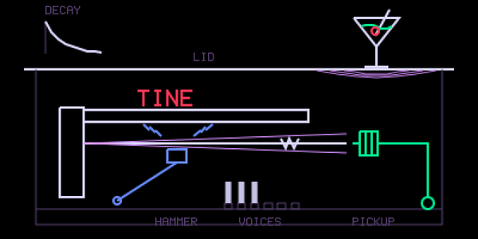
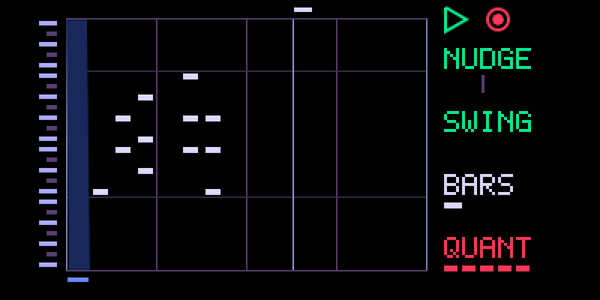
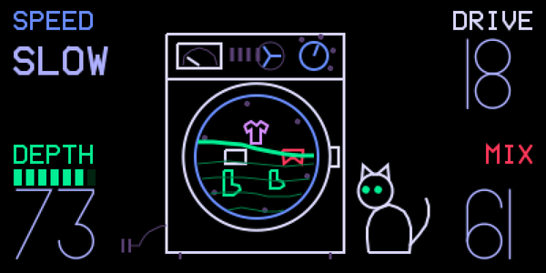
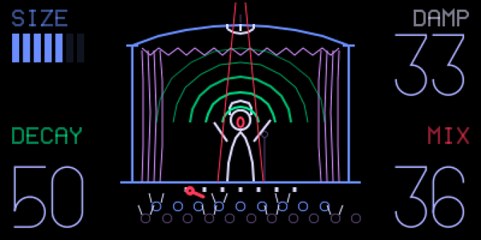
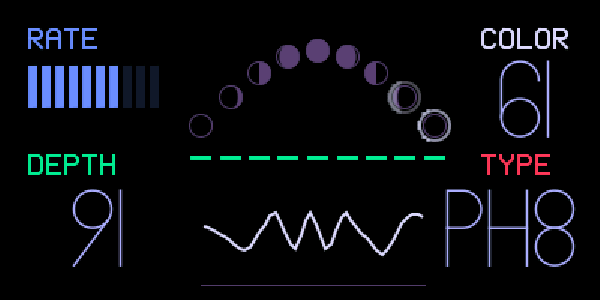
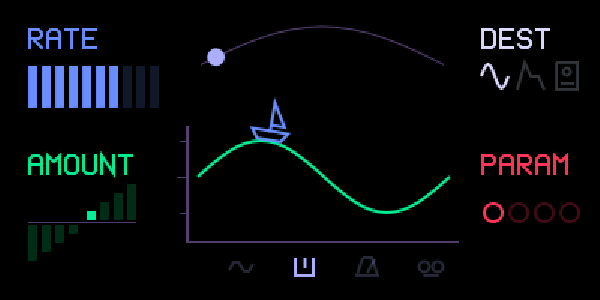
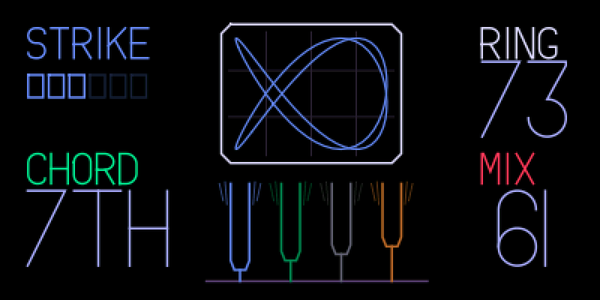
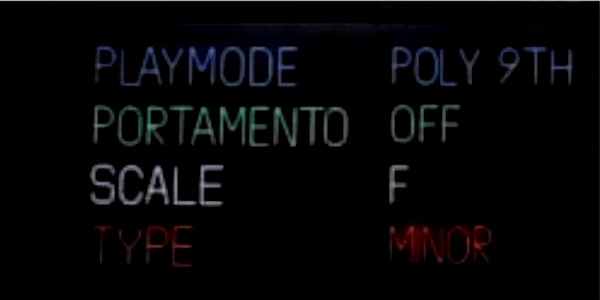

# OP-1 Mods 1.0

New stuff for the original OP-1's firmware: a KEYS synth engine, chord mode and scales, a piano-roll sequencer, six new effects with their own screens, a new LFO, a knob-click Shift latch, and MIDI CC on almost every knob. It's a patch for teenage engineering's stock firmware 246, the last one they released for the OG. It's free.

**Video:** https://youtu.be/OytN1z0QtyQ

**Want an email when there's a new build?** Sign up at [justinjoe.com/op1-mod](https://justinjoe.com/op1-mod). Optional, the files are all right here.

Original OP-1 only, not the OP-1 Field.

## What's in it

- **KEYS.** A new synth engine: tine electric piano, reed and clav. No samples. BARK stands in for velocity, TONE moves the pickup, DECAY sets the ring, TYPE picks the instrument. Six voices, three presets in a KEYS folder.
- **Chord mode.** One key plays a whole chord. Twelve shapes (triad, 7th, 9th, sus2, sus4, 6th, add9, power, octave, open, shell, quartal) plus parallel m7 / m9 / Maj7. The chord notes follow the scale you set.
- **Scales.** The white keys play the scale and root you pick. This started as stfj's note quantization patch. I moved it in memory so it stops crashing some units, and fixed the scale tables (every scale except C major was coming out a fourth off).
- **TRACK.** A seventh sequencer with a piano roll and a grid. Play it in live or punch notes in at a step, nudge, swing, loop length, quantize. It records the chords from chord mode and starts and stops with the tape.
- **Six effects, each with its own screen:**
  - CRUSH: bitcrusher (sample-rate crush, DENTS, mix, low-pass)
  - BELL: a ring mod feeding four tuned strings that retune to each note's chord tones
  - MOON: eight-stage phaser to four-stage, into a Uni-Vibe, into vibrato
  - MIMIC: tempo-locked echo, 1/32 to 1/2, repeats past 100%, AGE for saturation and wow, ping-pong on the master
  - LINGER: plate reverb with a freeze at the top of DECAY
  - SPIN CYCLE: rotary speaker, BRAKE / SLOW / FAST / AUTO, stereo on the master
- **TIDE.** An LFO with seven shapes (including sample-and-hold and smooth random), start phase, skew, and free / key / beat / tape sync. It can target the new effects.
- **Shift latch.** Press any knob and the knobs switch to their Shift job without holding Shift. Press again or change page to drop it.
- **MIDI CC.** Over USB, CCs set the knobs of the sound you're playing: engine, envelope, effect, LFO and master effect. The screen follows and the values save with the patch. KEYS' own four knobs don't take CC yet. Full chart in the manual.

| | | |
|---|---|---|
|  |  |  |
|  |  |  |
|  |  |  |

## What's in this repo

- `op1-mod-1.0.op1patch`: my changes. Nothing of teenage engineering's is in it.
- `apply.py`: applies the patch to TE's official firmware file on your computer. Python 3.8 or newer, nothing to install.
- `OP-1_Mods_User_Manual_1.0.pdf`: every module, the full MIDI CC chart, known limits, troubleshooting.

## Install

Back up your OP-1 first: disk mode (Shift + COM, then T3) and copy the whole drive to your computer.

1. **Get the official firmware.** Download `op1_246.op1` from teenage engineering's OP-1 downloads page. It has to be 246.
2. **Make the modded file.** Put `op1_246.op1`, the patch and `apply.py` in one folder, open a terminal there and run
   `python3 apply.py op1_246.op1 op1-mod-1.0.op1patch`
   It checks that the firmware file is the exact one the patch was made for, writes a new `.op1` next to it and verifies it. If the check fails it writes nothing.
3. **Upload mode.** Power off and unplug USB. Hold COM while you switch it on. Press 1, then plug in USB. A drive called OP-1 shows up.
4. Copy the new `.op1` file onto that drive and eject it.
5. **Press COM on the OP-1** to start the update. Don't pull the cable or power off. It takes several minutes.
6. Power cycle. It boots to the tape like always. Your tape and sounds are untouched.

The bootloader (te-boot) is never touched, so a bad flash can be redone.

## Going back to stock

Stock firmware doesn't know the new engine, effects or LFO. If any synth sound, drum sound or the master is using KEYS, ITER, CRUSH, BELL, MOON, MIMIC, LINGER, SPIN CYCLE, FILTER or TIDE when you flash stock, the OP-1 stops at boot with "Invalid synth patch".

Before you go back, switch those sounds to a stock engine, effect or LFO, then flash the official `op1_246.op1` the same way. If you forgot, no factory reset needed: flash the mod again, switch the sounds, then go back.

TRACK, chord mode, scales and the Shift latch don't have this problem. Stock just ignores them.

## Compatibility

This is its own patch on stock 246. It doesn't stack with op1r, op1-workshop or OPUS: pick one. Sounds saved with this mod's engine, effects or LFO need this mod to load.

## How it was built

Written in C for the OP-1's Blackfin with a lot of help from Claude, tested in an OP-1 emulator first, then on two OP-1s of different hardware revisions (including the kind that crashed on the original scale patch). Every effect was rendered and picked by ear before it went on the unit.

## Credits

- Scales start from [stfj's note quantization patch](https://github.com/stfj/OP-1-Note-Quantization-PublicGit).
- ITER and FILTER are teenage engineering's own hidden engine and effect; this build just lists them.

## Support

Something broke, or it works great? Open an issue here or find me on [Discord](https://discord.gg/35VBxwkh8U). Tell me which OP-1 you have and what you were doing when it happened.

It's free and it stays free. If you want to say thanks: [buymeacoffee.com/justinjoe](https://buymeacoffee.com/justinjoe)

---

Unofficial, community-made modification. Not affiliated with, endorsed by, or supported by teenage engineering. "teenage engineering" and "OP-1" are trademarks of teenage engineering AB. Installing modified firmware is at your own risk and may void your warranty. For the original OP-1 only.
